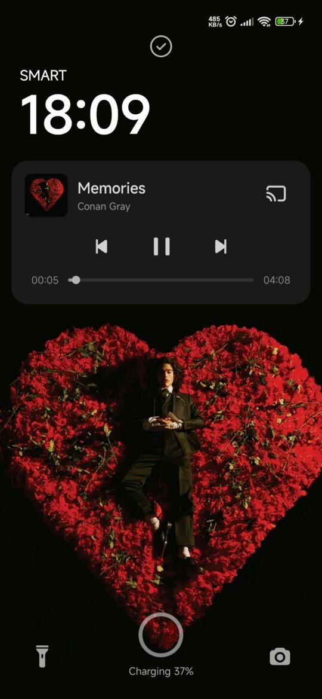
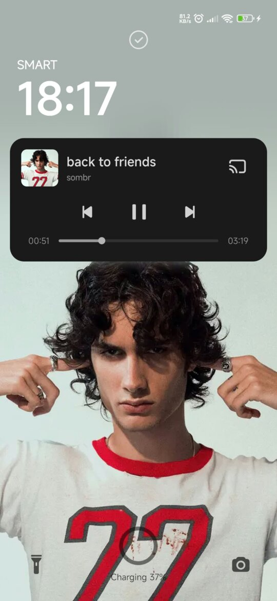
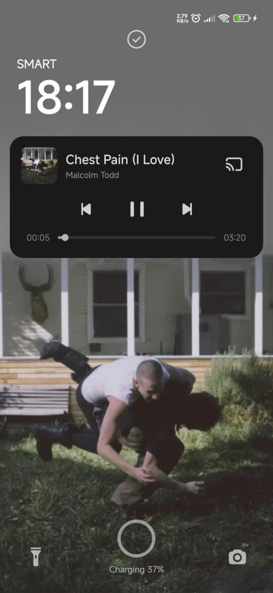
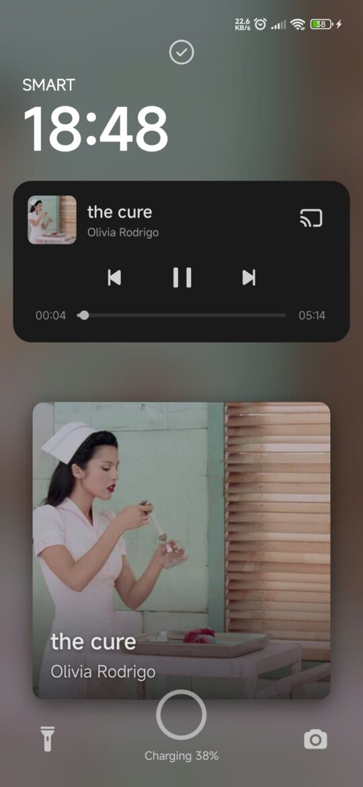
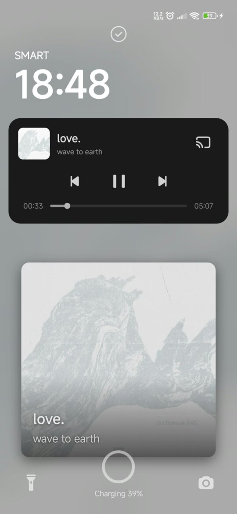
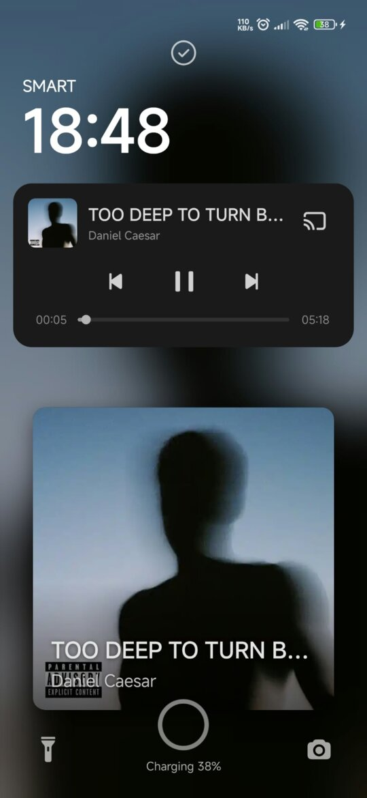
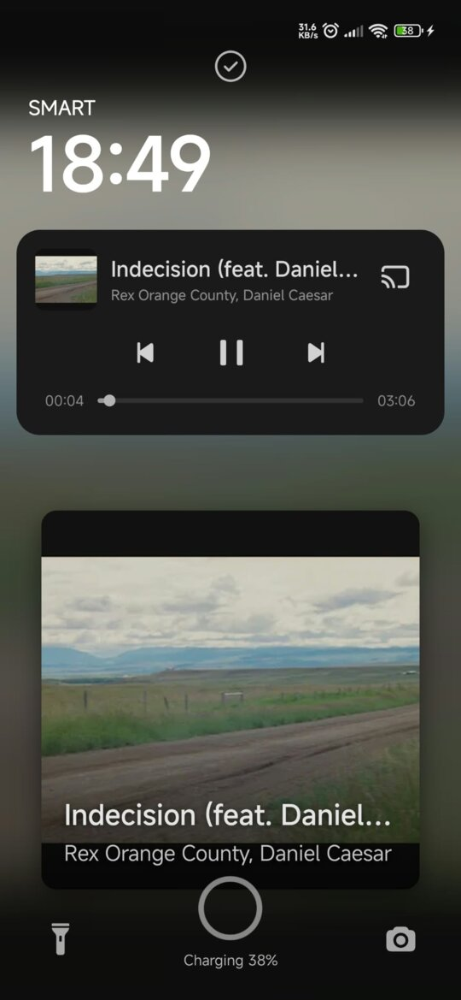

# MusicPaper

MusicPaper is an Android application that displays the current track's album artwork as your lock screen wallpaper. It reads media sessions from the music applications you select, updates the wallpaper as tracks change, and restores a default image when playback stops.

[](https://github.com/CharlesTogle/MusicPaper/releases/latest)
[](LICENSE)


## Screenshots

**Classic layout**

<p align="center">
  
  
  
  
</p>

**Square layout** with title and artist

<p align="center">
  
  
  
  
</p>

## Features

- **Player selection:** Choose which applications can update your wallpaper. Supported sources include Spotify, YouTube, YouTube Music, and local players that expose Android media sessions and cover artwork.
- **Wallpaper layouts:** Choose a cover-derived colour background or a square cover over a blurred background. Preview both layouts with the current track's artwork.
- **Animated transitions:** Enable the MusicPaper live wallpaper to fade between covers as tracks change.
- **On-device upscaling:** Choose Lanczos resampling or Real-ESRGAN image enhancement, with GPU acceleration on supported devices and a CPU fallback.
- **Default wallpaper:** Choose a lock screen image to restore when playback stops, or retain the last cover by disabling restoration.

## Installation

MusicPaper requires Android 8.0 (API 26) or newer and a 64-bit ARM device (`arm64-v8a`).

1. Download the APK from the [latest release](https://github.com/CharlesTogle/MusicPaper/releases/latest).
2. Open the APK and allow installation from your browser or file manager if prompted.
3. Open MusicPaper. Under **Setup → Notification access**, select **Grant** and enable access in Android settings.
4. Select your players under **Music apps**.
5. Start playback in a selected player, then lock your device to view the artwork.

If Android blocks notification access as a restricted setting, open **Settings → Apps → MusicPaper → ⋮ → Allow restricted settings**, then grant access again. This may apply to sideloaded installations on Android 13 and later.

Under **Setup → Run in background**, select **Allow** to request an exemption from battery optimisation. Xiaomi, Redmi, and POCO users can also open **Autostart** from Setup to enable it for MusicPaper.

## Configuration

### Layout

Choose a layout under **Style → Layout**.

| Layout | Appearance | Options |
|---|---|---|
| **Classic** | Album artwork beneath a solid colour derived from the cover. | Enable **Fill the screen** to crop the artwork to the screen dimensions. |
| **Square** | A centred square cover over a blurred copy of the artwork. | Enable **Show title** and **Show artist** to add track information to the cover. |

Layout previews approximate the result; the device's lock screen controls may overlap the artwork.

### Animated covers

Under **Style → Animated covers**, select **Set** to open Android's live wallpaper preview, then confirm MusicPaper as the wallpaper. Choose **Home screen and lock screen** when prompted.

To keep album artwork on the lock screen, choose a home screen image under **Wallpapers → Home screen**. MusicPaper uses that image to replace its live wallpaper on the home screen.

### Lock screen themes

MusicPaper sets covers in one of two ways, and they differ in how they work with your phone's lock screen theming (clock styles, widgets, and similar options).

| Mode | How covers are set | Lock screen themes |
|---|---|---|
| **Still image** (default) | Each cover is set as a static lock screen wallpaper, the same path as **Apply now**. | Compatible. |
| **Animated covers** | MusicPaper's live wallpaper draws the covers itself. | Not supported. The phone cannot theme a live wallpaper, so some phones reset the lock screen to their default style. |

If your lock screen uses theming, such as a custom clock style or widgets, use still images and leave **Animated covers** off. Otherwise, either mode works.

To return to still images, set any other wallpaper in your phone's settings; MusicPaper resumes setting covers as a static image.

On Xiaomi, Redmi, and POCO phones (HyperOS), wallpaper effects such as depth effect turn off whenever an app other than Xiaomi's own sets the lock screen wallpaper, so they are unavailable in either mode.

### Upscaling

Choose a mode under **Style → Upscaling**.

| Mode | Behaviour |
|---|---|
| **Simple** | Enlarges artwork with Lanczos resampling. Uses less processing power and battery. |
| **Advanced** | Enhances artwork with the Real-ESRGAN `realesr-general-x4v3` model through LiteRT. Uses the GPU where supported, with a CPU fallback. |

Advanced mode displays a resampled image while it processes the enhanced version. Processing time depends on the device and artwork size. MusicPaper caches enhanced images on the device for reuse.

### Default wallpaper

Choose an image under **Wallpapers → Lock screen** and enable **Style → Default when music stops** to restore it after playback stops or the player closes. Pausing playback retains the current cover.

Without a default image, MusicPaper restores the lock screen to match the home screen wallpaper. It stores a private copy of each chosen wallpaper, so deleting the original image does not remove the saved copy.

## Permissions and privacy

MusicPaper requires no account and includes no analytics. Wallpaper rendering and image enhancement run on the device. Network access supports artwork downloads when a player supplies an image URL, and a check for a newer GitHub release when the app opens (no personal or device data is sent).

| Access | Purpose | Approval |
|---|---|---|
| `SET_WALLPAPER` | Update and restore wallpaper. | Android grants this at installation. |
| Notification access | Read media sessions and cover artwork from selected players. | Enable it in Android settings. Android grants app-wide notification access; MusicPaper filters processing to the players you select. |
| `INTERNET` | Download cover artwork from URLs supplied by a player, and check GitHub for a newer release when the app opens. | Android grants this at installation. |
| `REQUEST_IGNORE_BATTERY_OPTIMIZATIONS` | Request an exemption from battery optimisation to support background operation. | Approve the request through **Setup → Run in background**. |

## Building from source

Install JDK 17 and the Android SDK, including SDK Platform 36. Configure the SDK path through `ANDROID_HOME` or a `local.properties` file containing `sdk.dir`.

```bash
git clone https://github.com/CharlesTogle/MusicPaper.git
cd MusicPaper
./gradlew assembleDebug
```

The debug APK is available at `app/build/outputs/apk/debug/app-debug.apk`. To install it on a connected device with USB debugging enabled:

```bash
adb install app/build/outputs/apk/debug/app-debug.apk
```

### Source structure

Application source files are in [`app/src/main/java/dev/musicpaper/`](app/src/main/java/dev/musicpaper/).

| File | Responsibility |
|---|---|
| `MusicListenerService.kt` | Monitor media sessions from selected players and trigger wallpaper updates. |
| `MediaReader.kt` | Extract track metadata and cover artwork. |
| `WallpaperRenderer.kt` | Render layouts, backgrounds, and optional track captions. |
| `Upscaler.kt` | Resample artwork and run the Real-ESRGAN model. |
| `WallpaperApplier.kt` | Apply wallpaper images, restore defaults, and import chosen images. |
| `CoverWallpaperService.kt` | Render live wallpaper and animate transitions between covers. |
| `MainActivity.kt`, `*Section.kt`, `*Picker.kt` | Provide setup, player selection, and appearance controls. |

### Upscaler model

The repository includes the model at `app/src/main/assets/upscaler_x4.tflite`; a standard application build does not require model conversion.

To regenerate the model from the released Real-ESRGAN weights, follow the environment setup and conversion commands at the top of [`tools/convert_upscaler.py`](tools/convert_upscaler.py).

## Contributing

See [CONTRIBUTING.md](CONTRIBUTING.md) for bug report requirements, development guidelines, and pull request instructions. Submit bug reports and feature requests through [GitHub Issues](https://github.com/CharlesTogle/MusicPaper/issues).

## License

MusicPaper uses the [MIT License](LICENSE).

The bundled upscaler model derives from [Real-ESRGAN](https://github.com/xinntao/Real-ESRGAN) by Xintao Wang under the BSD 3-Clause License. See [`upscaler_x4.LICENSE.txt`](app/src/main/assets/upscaler_x4.LICENSE.txt) for the model's license terms.
