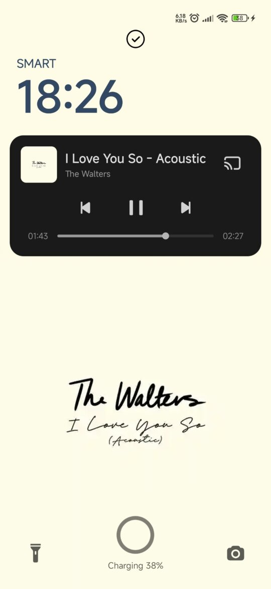

<div align="center">

# 🎵 MusicPaper

**Your lock screen, dressed in whatever you're listening to.**

MusicPaper is an Android app that sets your lock screen wallpaper to the album cover of the song that's playing,
and puts your own wallpaper back when the music stops.

[](https://github.com/CharlesTogle/MusicPaper/releases/latest)
[](LICENSE)


[](CONTRIBUTING.md)

</div>

---

## 📸 Screenshots

<p align="center">
  
  
  
  
</p>

## ✨ Features

- **Works with any player.** Spotify, YouTube, YouTube Music, local music players: anything that publishes an Android media session.
- **You choose which apps.** Only the players you tick in the app list can change your wallpaper.
- **Two layouts.** A solid colour picked from the cover, or the full cover over a blurred copy of itself. Live previews use the song that's playing.
- **On-device AI upscaling.** Small 300–640px covers are sharpened with [Real-ESRGAN](https://github.com/xinntao/Real-ESRGAN), running on your phone's GPU.
- **Falls back cleanly.** When the music stops, your lock screen goes back to the image you picked (or to your home screen wallpaper).
- **Private.** No accounts, no analytics, no uploads. Nothing leaves the phone.

## 📥 Install

1. Download the latest APK from the [Releases page](https://github.com/CharlesTogle/MusicPaper/releases/latest).
2. Open it on your phone and allow installing from your browser or file manager when asked.
3. **Android 13+ only:** sideloaded apps can't get notification access until you allow it.
   Go to **Settings → Apps → MusicPaper → ⋮ → Allow restricted settings**.
4. Open MusicPaper, tap **Grant** to turn on notification access, and tick the music apps you use.
5. Play a song and lock your phone. 🎶

> Requires Android 8.0 (API 26) or newer on a 64-bit ARM (`arm64-v8a`) phone.

## 🎨 Customising

### Layout
Pick one under **Style → Layout**:

| Layout | What it looks like |
|---|---|
| **Current** | A solid colour taken from the cover, with the cover above it. Turn on **Fill the screen** to crop the cover to fill instead. |
| **Square** | The whole cover as a centred square over a blurred copy of itself. |

### Upscaling
Pick one under **Style → Upscaling**:

| Mode | How it works |
|---|---|
| **Simple** | Lanczos resampling. Fast and light on battery. |
| **Advanced** | Real-ESRGAN (`realesr-general-x4v3`) runs on the phone, on the GPU when it can. The simple version shows first and the sharp one replaces it a few seconds later. Results are cached, so a song you replay is instant. |

### Default wallpaper
Pick an image under **Default wallpaper**. When the music stops (the player is stopped or closed, not just paused),
the lock screen goes back to it. If you haven't picked one, the lock screen goes back to matching your home screen.
MusicPaper keeps its own copy, so deleting the original photo doesn't break it.

## 🔐 Permissions

| Permission | Why | How it's granted |
|---|---|---|
| `SET_WALLPAPER` | To change the lock screen. | Automatically at install; Android shows no dialog. |
| Notification access | To see which song is playing and get its cover. | You turn it on in system settings. Only the apps you tick are read. |
| `INTERNET` | Only used when a player gives a cover URL instead of an image. | Automatically at install. |

## 🛠️ Building from source

**Requirements:** JDK 17 and the Android SDK (compile SDK 36).

```bash
git clone https://github.com/CharlesTogle/MusicPaper.git
cd MusicPaper
./gradlew assembleDebug
adb install app/build/outputs/apk/debug/app-debug.apk
```

### Project layout

```
app/src/main/java/dev/musicpaper/
├── MusicListenerService.kt    # listens to media sessions from the selected apps
├── MediaReader.kt             # pulls title, artist, and cover out of a session
├── WallpaperRenderer.kt       # draws the chosen layout
├── Upscaler.kt                # Real-ESRGAN tiling on LiteRT (GPU with CPU fallback)
├── WallpaperApplier.kt        # sets / restores the lock screen
└── MainActivity.kt + *Section.kt, *Picker.kt   # the settings UI
tools/convert_upscaler.py      # rebuilds the .tflite upscaler model
```

### Rebuilding the upscaler model
`app/src/main/assets/upscaler_x4.tflite` is generated by [`tools/convert_upscaler.py`](tools/convert_upscaler.py)
from the released Real-ESRGAN weights. The steps are at the top of that file.

## 🤝 Contributing

Contributions are welcome! Bug reports, ideas, and pull requests all help.
Read [CONTRIBUTING.md](CONTRIBUTING.md) to get started, or browse the [open issues](https://github.com/CharlesTogle/MusicPaper/issues).

## 📄 License

MusicPaper is released under the [MIT License](LICENSE).

The bundled upscaler model is derived from [Real-ESRGAN](https://github.com/xinntao/Real-ESRGAN) by Xintao Wang,
used under the BSD 3-Clause License ([`upscaler_x4.LICENSE.txt`](app/src/main/assets/upscaler_x4.LICENSE.txt)).
